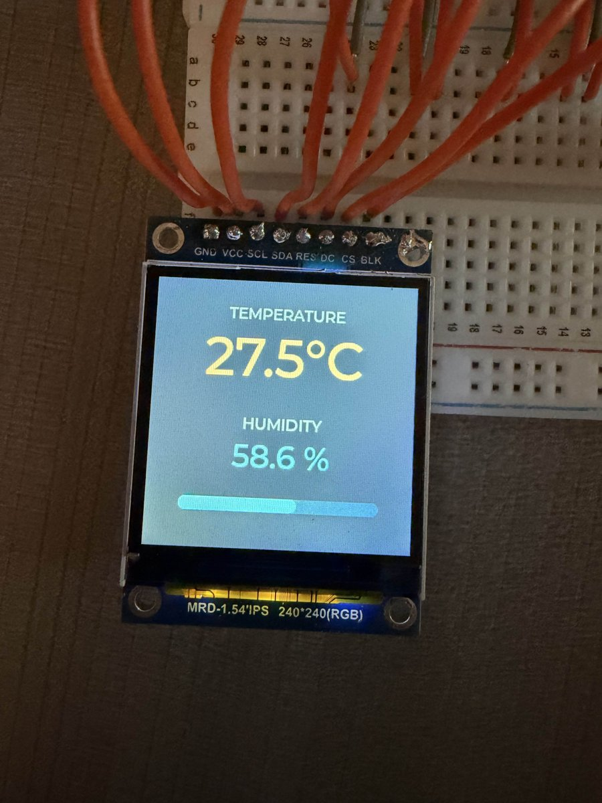
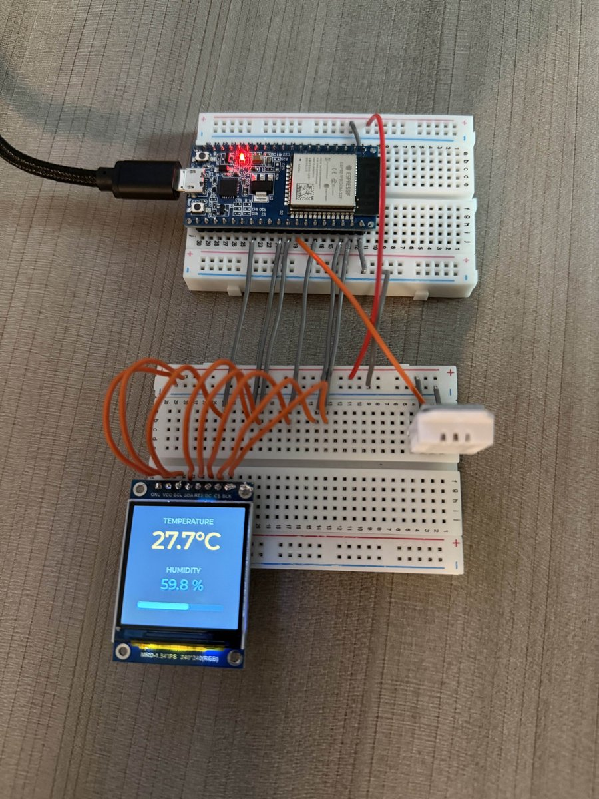

# Water Plant Display

An ESP32 project that reads temperature and humidity from a DHT22 sensor and shows them on a 1.54" ST7789 LCD.



Built with ESP-IDF and [LVGL](https://lvgl.io). The DHT22 driver is written from scratch in [main/dht22.c](main/dht22.c).

## Hardware

| Part | Details |
|---|---|
| Microcontroller | ESP32 dev board (ESP32-WROOM) |
| Display | 1.54" IPS LCD, 240×240, ST7789 driver, SPI |
| Sensor | DHT22 / AM2302 on a 3-pin breakout (`+`, `out`, `-`) |

## Wiring



### Display

| Display pin | ESP32 GPIO |
|---|---|
| VCC | 3.3V |
| GND | GND |
| SCL | 4 |
| SDA | 5 |
| RES | 18 |
| DC | 21 |
| CS | 22 |
| BLK | 23 |

### Sensor

| Sensor pin | ESP32 |
|---|---|
| `+` | 3.3V |
| `-` | GND |
| `out` | GPIO 19 |

To use different pins, change the `PIN_*` defines in [main/display.c](main/display.c) and `SENSOR_PIN` in [main/main.c](main/main.c).

## Building and flashing

Requires [ESP-IDF](https://docs.espressif.com/projects/esp-idf/en/latest/esp32/get-started/) v6.1.

```sh
idf.py build
idf.py -p /dev/ttyUSB0 flash monitor
```

The first build downloads LVGL and `esp_lvgl_port` into `managed_components/` (versions pinned in `dependencies.lock`).

A dev container setup is included in `.devcontainer/` for building inside Docker.

## Project layout

| File | Purpose |
|---|---|
| [main/main.c](main/main.c) | Entry point: sets up the display and sensor, reads every 2 s |
| [main/display.c](main/display.c) | SPI bus and ST7789 setup, hands the panel to LVGL |
| [main/dht22.c](main/dht22.c) | DHT22 single-wire protocol driver |
| [main/ui.c](main/ui.c) | Screen layout (labels and humidity bar) |
| `sdkconfig.defaults` | Project settings that apply on a fresh build (enables LVGL fonts) |
| `main/idf_component.yml` | Component dependencies (LVGL) |

## Troubleshooting

- **Black screen with the backlight on:** check the display wiring first, then try lowering `LCD_PCLK_HZ` in `display.c` to 10 MHz.
- **Colors look inverted:** change `esp_lcd_panel_invert_color(panel, true)` to `false` in `display.c`.
- **`no response from sensor` on every read:** check the `out` and `+` wires. An occasional `checksum mismatch` is normal.
